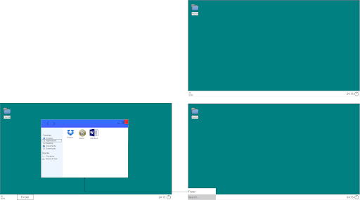

<!--
Source: "Projects/Design docs/WIP_ Project OS SIIVOA.docx" from the 2026-09-23 Google Drive
export (Projects-20260923T130158Z-1-001.zip). Converted to Markdown with
pandoc 3.7 (gfm) on 2026-09-23; wording and structure kept as written.
-->

# **Kansi**

Project OS

Versio: 0.1

Markus Jylhänkangas

2017

# **Sisällys luettelo**

1.  Johdanto

2.  Vaatimukset

3.  Vaihtoehtojen kartoitus

    1.  Windows

    2.  MacOS

    3.  Linux

        1.  Ubuntu

        2.  Fedora

        3.  OpenSUSE

    4.  FreeBSD

        1.  TrueOS

    5.  ReactOS

    6.  HaikuOS

    7.  iOS

    8.  Android

    9.  Windows Phone

    10. Meego/Jolla/Tizen/Plasma mobile

    11. Redox

4.  Ratkaisu 2. Mitä toteutus vaatisi

5.  Lähteet

# **Johdanto**

Kun dokumentissa viitataan käyttöjärjestelmään tarkoitetaan sillä käyttöjärjestelmää, yhteisöä ja koko ekosysteemiä siihen liittyen. Tässä dokuemntissa tutkitaan ja vertaillaan eri käyttöjärjestelmien soveltuvuutta kehittäjälle, ja piirretään kuvaa ideaalista käyttöjärjestelmästä. Vertailussa otetaan huomioon käyttöjärjestelmien käytettävyys, Kehitysympäristö, kirjastot, editorit, debuggaus, deployment. Tarkoituksena on löytää paras mahdollinen käyttöjärjestelmä missä kehittäjä voi olla most productive.

# **Vaatimukset**

Mitkä ovat vähimmäis vaatimukset mitä vaaditaan.

Mutta koska elämme jo vuotta 2017 vain nämä eivät riitä joten tässä on lisä vaatimusia mitkä olisi hyviä.

vaatimuksia...

# **Vaihtoehtojen kartoitus**

Tässä osiossa käydään läpi eri käyttöjärjestelmä vaihtoehtoja. Osa käyttöjärjestelmistä on vasta kehitys vaiheessa ja osa on suunniteltu mobiili alustoille, mutta käymme nämä silti läpi hyvien ominaisuuksien toivossa. Vertailussa otetaan huomioon käyttöjärjestelmien nykyinen tilanne seka tulevaisuuden tavoitteet joihin suuntiin näitä viedään.

# **Sekalaista**

Rescue mode

HaikuOS End-user desktop OS.

haikuOS/beos multicore.

haikuOS package manager.

Save previous states of applications. before update, after update etc.

## **Mitä pitää ottaa huomioon kehityksessä**

- 10 vuoden suunnitelma

- Elämän tilanteet voi muuttua

- Rahat voi loppua

- Ihmisiä voi tulla mukaan projektiin ja lähteä pois

- Tarpeet käyttöjärjestelmältä voi muuttua

- Kun opin uutta voi idea hyväs käyttiksestä muuttua

## **Hardwaren vähittäis vaatimukset**

## **Esim. Multitouch touchpad**

## **kerätyt ideat**

### **Kuvaus**

RELIABILITY The design of reliabile software

Ulkoasuun ja käytettävyyteen otetaan parhaat palat windowsilta ja os x.

Tulot mitä firma saa niin ennalta määrätty osa menee projektien tukemiseen. Selkeä graaffi miten tulot jaetaan.

Mikrokernel

### **Idea**

Kun käyttöjärjestelmä lähtee boottaamaan tekee se perus hardware käynnistykset ja ottaa muistit haltuun jne. Käyttöjärjestelmä luo kevyen "virtuaalikoneen" jonka päällä kaikki pyörii. Mikään ohjelma ei pääse suoraan rautaan kiinni vaan kaikki käyttävät "virtuaalikoneen" rautaa. Kaikki ohjelmat pyörivät omissa "sandboxeissa", mutta voivat pyytää lupaa pääsemään käsiksi sandboxin ulkopuolelle (esim. hakea dataa toisesta ohjelmasta, netti, levy tallennus).

Koneen boottaus pitää luultavasti koodata C/rust/assembly tai jollain muulla konekielelle kääntyväksi, Mutta kaikki kirjoitetaan jollain dynaamisemmalla kielellä (clojure).

Käyttöjärjestelmässä on sisään rakennettu tehokas JVM/BEAM tai saman tyylinen moottori jossa pyörii suurin osa käyttiksestä.

Fault Tolerant: ohjelmat ei kaadu samantien, eikä ohjelmat voi hidastaa konetta. skaalautuva: Virtuaalikone käyttää hyödyksi kaiken tehon mitä koneesta saa ja koneesen voi helposti yhdistää lisää teho yhdistämällä koneita klusteriin. Asetuksista käyttöliittymästä löytyy asetus josta voi helposti yhdistää koneita. Käyttis osaa jakaa työtaakkaa monien prosessoreiden sekä koneiden kanssa.

concurrent: jvm hoitaa ohjelmien jakamisen ytimien kanssa

Sopiiko mikään ohjelmointi kieli? Muokattu clojure?

### **Tärkeitä ominaisuuksia**

- Mac os X tyylinen sovelluksien fullscreen systeemi

- Windows 10 alapalkki. Windows painikkeen tilalla hakupalkki

- Hyvä tuki dropbox/google drive/onedrive

- Varmuuskopiointi

  - Filesystem snapshots

  - Hyvä backup ominaisuudet (käyttää snapshotteja)

  - Palvelu johon voi backupata tietokoneen asetuset (taustakuvat, palkkien värit yms.)

  - Koneelle kun tekee käyttäjän ja kirjautuu palvelun tunnuksiaa, käyttis hakee asetukset palvelusta.

- Hyvä fontti renderöinti vakiona

- Helppo kehittää sovelluksia

  - Yksi kieli mitä tuetaan (ainakin aluksi)

  - Yhtä helppo tehdä hienoja graaffisia sovelluksia kuin androidilla

  - Koodin pitäisi olla simppeliä ja siistiä

  - Hyvä työkalut

- Package manager

  - pakettien haltioilla on web näkymä josta näkee sähyödyllistä statistiikkaa omista paketeista

  - kehittäjät voivat myös saada debug/crash dump tietoja palvelun kautta

  - Fedora tyylisiä ohjelma paketteja (c-developer, web-developer, php-developer, office, windows-developer)

  - Ei tarvitse olla open-source

  - Opensuse one-click tyylinen tapa missä nettisivuille voi laittaa linkin ohjelmaan package managerista ja kun linkistä klikkaa käyttis asentaa ojelman.

  - web käyttöliittymän kautta kehittäjät voivat uploadata ohjelmia

  - Web api jolla voi uploadata packetteja package manageriin

  - Paketit skannataan viiruksilta

  - Pakottaa kehittäjät seuraamaan tiettyä laatua

  - Kehittäjien ei tarvitse tehdä installer wizardeja vaan he laittavat ohjelmat pakettiin ja käyttöjärjestelmä tarjoaa asennus homman. asennus wizardilla jokin api jolla sitä voi muokata.

### **Valmiiksi asennettuja sovelluksia**

- MS office jos mahdollista(trial versio, käyttäjän pitää ostaa jos haluaa kokoversion. \$\$\$\$ from microsoft), muuten libre office

- jokin archive sovellus

- pdf reader

- selain (firefox?)

- Windowsin notepad tyylinen editori missä ei mitään asetuksia

- paint tyylinen piirto ohjelma

### **Ohjelmat mitkä pitäisi saada toimimaan (default sovelluksien lisäksi)**

- Adobe ohjelmat

- Virtualbox

- Office

## **Mockup**

_Mockup source_

## **Lähdekoodeja**

- _FreeBSD source_

- _TrueOS_

- _Redox_
